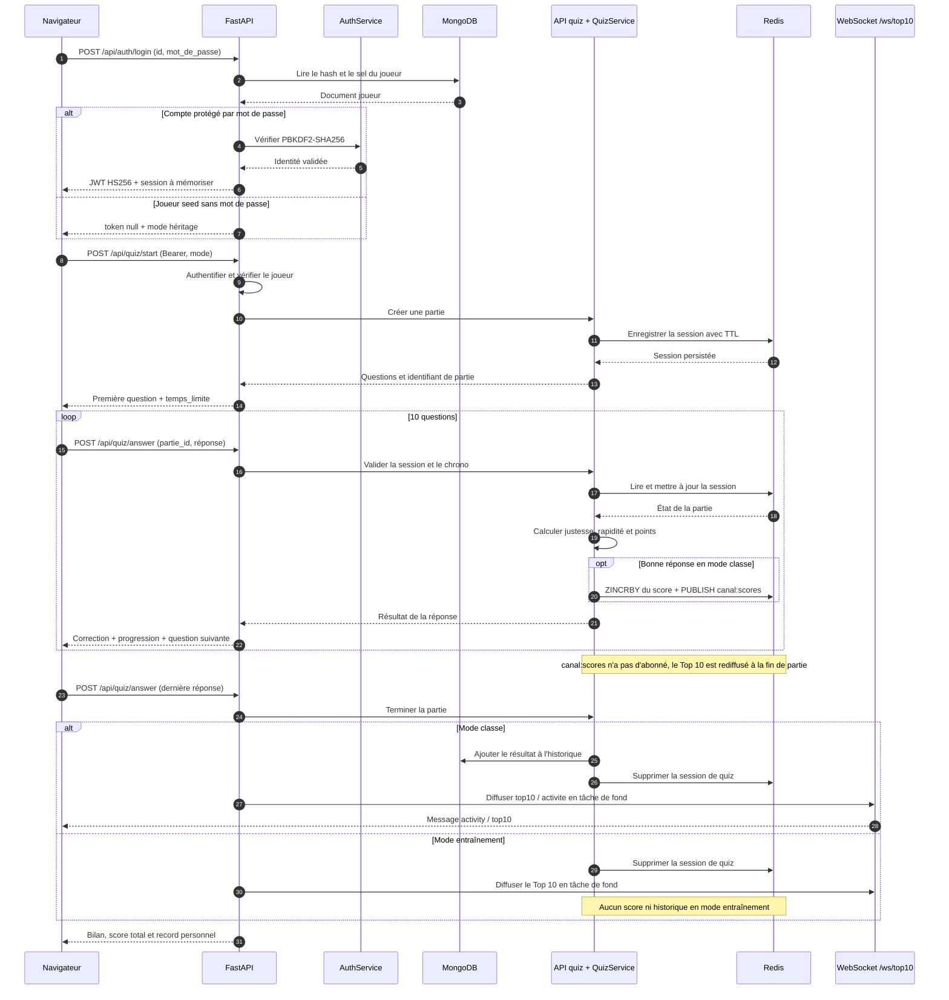
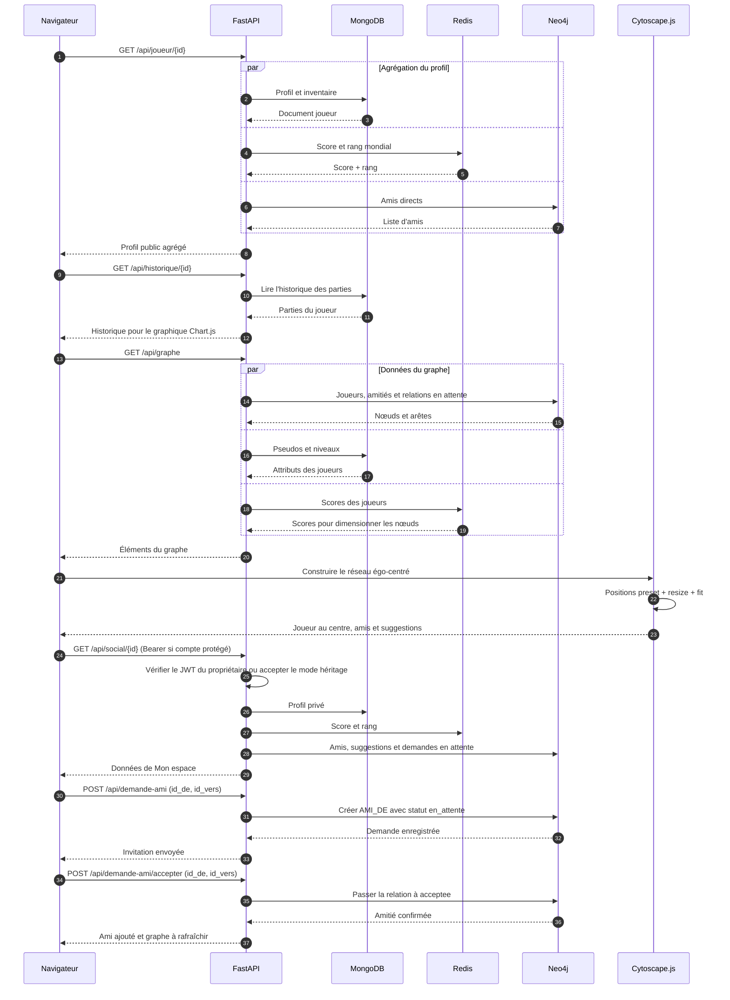
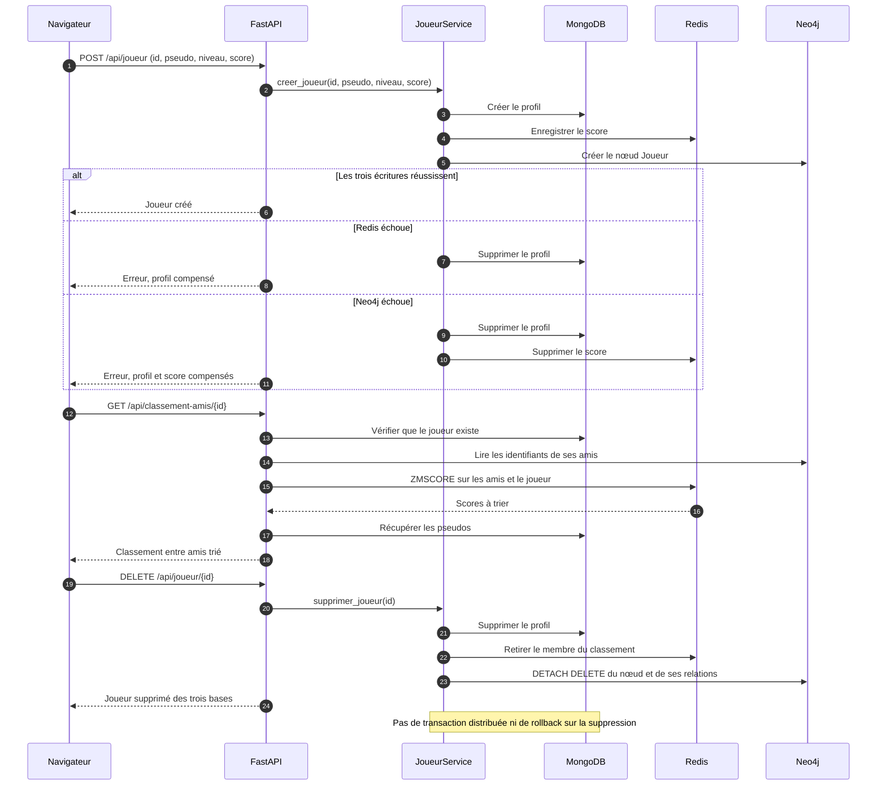
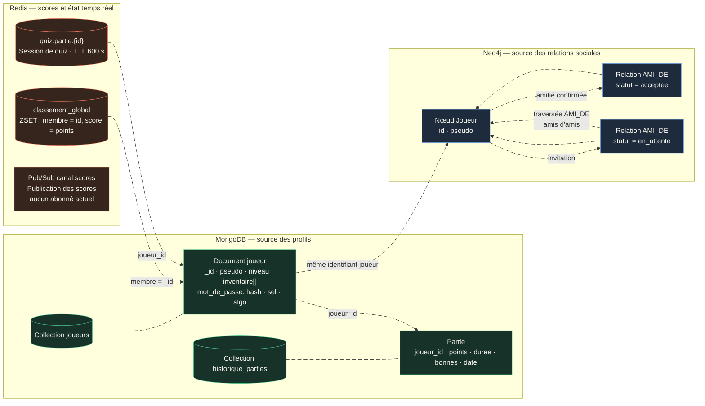
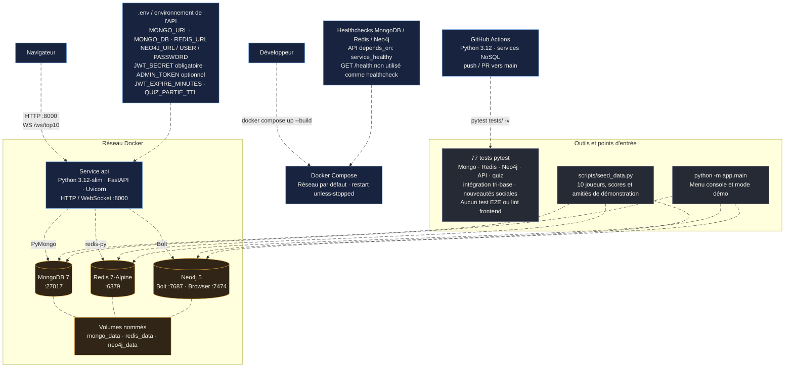

# Jeu en Ligne

[](https://github.com/sihamchaaboud-max/jeu-en-ligne/actions/workflows/ci.yml)

Projet de jeu en ligne multi-joueurs utilisant trois bases de données NoSQL :
- **MongoDB** : profils des joueurs et inventaires (+ mots de passe hashés)
- **Redis** : scores et classements (Top 10 global, classement entre amis), **sessions de quiz**
- **Neo4j** : relations d'amitié et recommandations (amis d'amis)

## Répartition du travail

| Personne  | Base    | Module                  | Responsabilités |
|-----------|---------|-------------------------|-----------------|
| Personne 1| MongoDB | `mongo_service.py`     | Profils + inventaires |
| Oussama   | Redis   | `redis_service.py`     | Scores + Top 10 + classement amis + intégration |
| Personne 3| Neo4j   | `neo4j_service.py`     | Amis + amis d'amis |

## Architecture

### Structure du projet

```
jeu-en-ligne/
├── docker-compose.yml        # Lance MongoDB + Redis + Neo4j
├── architecture.md           # Architecture détaillée et diagrammes Mermaid
├── requirements.txt          # pymongo, redis, neo4j, python-dotenv, pytest
├── .env                      # URLs et mots de passe des bases
│
├── app/
│   ├── config.py             # Lit le .env (URL des 3 bases)
│   ├── main.py               # Menu console pour tester toutes les fonctions
│   ├── joueur_service.py     # Intégration : creer_joueur(), classement amis
│   └── services/
│       ├── mongo_service.py  # MongoDB : profils + inventaires
│       ├── redis_service.py  # Redis : scores + top 10
│       └── neo4j_service.py  # Neo4j : amis + amis d'amis
│
├── scripts/
│   └── seed_data.py          # 10 joueurs, amitiés, scores de test
│
├── tests/
│   ├── test_mongo.py
│   ├── test_redis.py
│   └── test_neo4j.py
│
└── docs/
    └── rapport.md
```

### Diagrammes Mermaid

Les liens des diagrammes de composants sont animés en continu. Leur mouvement reprend toutes les 25 secondes.

#### 1. Vue d'ensemble des composants

```mermaid
flowchart TB
    Joueur((Joueur))
    Admin((Administrateur))

    subgraph WEB["Client navigateur — frontend/"]
        Pages["SPA Dashboard par hash + page Quiz autonome<br/>HTML · CSS · interfaces responsive"]
        App["app.js<br/>Navigation · appels API · profils · tiroirs"]
        AuthUI["auth.js<br/>Connexion · JWT · localStorage arena_session"]
        SocialUI["social.js + reseau.js<br/>Mon espace · graphes Cytoscape · demandes d'ami"]
        RankUI["leaderboard.js<br/>Podium · pagination · classements"]
        QuizUI["quiz.js<br/>Questions · progression · réponses"]
        Notifications["notifications.js<br/>WebSocket · reconnexion exponentielle jusqu'à 30 s"]
        Enhancements["charts.js + premium.js<br/>Chart.js · animations d'interface"]
        Librairies["Bibliothèques et polices sans CDN<br/>Cytoscape 3.30.2 · Chart.js 4.4.3 · Lucide 0.460.0<br/>Inter · Sora · JetBrains Mono"]
    end

    subgraph API["Backend FastAPI — app/api.py"]
        Static["FastAPI StaticFiles<br/>GET / · GET /quiz · /static<br/>Documentation /docs · /redoc"]
        AuthAPI["Authentification<br/>POST /api/auth/login<br/>POST /api/auth/mot-de-passe"]
        PlayersAPI["Joueurs et profils<br/>GET /api/joueurs · GET /api/joueur/{id}<br/>POST /api/joueur · DELETE /api/joueur/{id}<br/>PUT /api/niveau/{id}"]
        InventoryAPI["Inventaire et historique<br/>POST /api/objet/{id} · DELETE /api/objet/{id}<br/>GET /api/historique/{id}<br/>GET /api/stats-joueur/{id}"]
        RankingAPI["Classements<br/>GET /api/top10 · GET /api/classement<br/>GET /api/classement-autour/{id}<br/>GET /api/classement-amis/{id}"]
        SocialAPI["Réseau social<br/>GET /api/graphe · GET /api/amis/{id}<br/>GET /api/amis-damis/{id} · GET /api/social/{id}<br/>POST/DELETE /api/ami · POST /api/demande-ami*"]
        QuizAPI["Quiz<br/>POST /api/quiz/start<br/>POST /api/quiz/answer"]
        WSAPI["WebSocket sans authentification<br/>/ws/top10 · événements top10 / social / activite<br/>Connexions suivies en mémoire, non partagées entre workers"]
        SystemAPI["Système et statistiques<br/>GET /health · GET /api/stats"]
        Security["Dépendances de sécurité<br/>JWT Bearer · X-Admin-Key<br/>contrôle du propriétaire"]
    end

    subgraph LOGIC["Services métier et adaptateurs — app/"]
        JoueurService["JoueurService<br/>Orchestration des trois bases"]
        AuthService["AuthService<br/>PBKDF2-SHA256 100 000 itérations<br/>JWT HS256 · expiration 12 h par défaut"]
        QuizService["QuizService<br/>Sessions · chrono serveur · calcul des points"]
        MongoService["mongo_service.py<br/>Profils · inventaires · historique"]
        RedisService["redis_service.py<br/>Scores · classements · sessions · Pub/Sub"]
        Neo4jService["neo4j_service.py<br/>Amitiés · invitations · suggestions"]
    end

    subgraph DATA["Persistance NoSQL"]
        Mongo[("MongoDB<br/>Documents joueurs")]
        Redis[("Redis<br/>Sorted sets · clés TTL · Pub/Sub")]
        Neo4j[("Neo4j<br/>Graphe social")]
    end

    Config["config.py + .env<br/>URLs · identifiants · JWT_SECRET"]

    Joueur -->|"HTTP :8000"| Static
    Admin -->|"HTTP :8000"| Static
    Static -->|"HTML / CSS / JS"| Pages
    Pages --> App
    App --> AuthUI
    App --> SocialUI
    App --> RankUI
    App --> QuizUI
    App --> Notifications
    App --> Enhancements
    Librairies -.-> SocialUI
    Librairies -.-> RankUI
    Librairies -.-> Enhancements

    AuthUI -->|"REST"| AuthAPI
    App -->|"REST"| PlayersAPI
    App -->|"REST"| InventoryAPI
    RankUI -->|"REST"| RankingAPI
    SocialUI -->|"REST"| SocialAPI
    QuizUI -->|"REST"| QuizAPI
    App -->|"REST"| SystemAPI
    Notifications -->|"WebSocket"| WSAPI

    Security -.->|"selon la route"| AuthAPI
    Security -.->|"selon la route"| SocialAPI
    Security -.->|"selon la route"| QuizAPI

    AuthAPI --> AuthService
    AuthAPI --> MongoService
    PlayersAPI --> JoueurService
    PlayersAPI --> MongoService
    PlayersAPI --> RedisService
    PlayersAPI --> Neo4jService
    InventoryAPI --> MongoService
    RankingAPI --> JoueurService
    RankingAPI --> MongoService
    RankingAPI --> RedisService
    SocialAPI --> Neo4jService
    SocialAPI --> MongoService
    SocialAPI --> RedisService
    QuizAPI --> QuizService
    QuizAPI --> RedisService
    QuizAPI --> MongoService
    SystemAPI --> MongoService
    SystemAPI --> RedisService
    WSAPI --> RedisService

    JoueurService --> MongoService
    JoueurService --> RedisService
    JoueurService --> Neo4jService

    MongoService -->|"PyMongo · :27017"| Mongo
    RedisService -->|"redis-py · :6379"| Redis
    Neo4jService -->|"Bolt · :7687"| Neo4j

    Config -.-> Static
    Config -.-> MongoService
    Config -.-> RedisService
    Config -.-> Neo4jService

    classDef client fill:#17233f,stroke:#6fa7e8,color:#f5f3ec;
    classDef api fill:#241d38,stroke:#b4a8f5,color:#f5f3ec;
    classDef service fill:#132c27,stroke:#4cc38a,color:#f5f3ec;
    classDef database fill:#302516,stroke:#f2b03d,color:#f5f3ec;
    classDef config fill:#262a34,stroke:#8a8fa3,color:#f5f3ec;
    linkStyle default stroke-dasharray: 9 5,stroke-dashoffset: 900,animation: dash 25s linear infinite;
    class Joueur,Admin,Pages,App,AuthUI,SocialUI,RankUI,QuizUI,Notifications,Enhancements,Librairies client;
    class Static,AuthAPI,PlayersAPI,InventoryAPI,RankingAPI,SocialAPI,QuizAPI,WSAPI,SystemAPI,Security api;
    class JoueurService,AuthService,QuizService,MongoService,RedisService,Neo4jService service;
    class Mongo,Redis,Neo4j database;
    class Config config;
```



#### 2. Authentification et déroulement d'un quiz



#### 3. Profil, réseau social et invitations



#### 4. Opérations transversales entre les trois bases



#### 5. Répartition des données entre les trois bases



#### 6. Déploiement, exploitation et qualité



## Prérequis

- Python 3.11+
- Docker et Docker Compose

## Installation

### 1. Lancer les bases de données

```bash
docker-compose up -d
```

Cela démarre :
- MongoDB sur `localhost:27017`
- Redis sur `localhost:6379`
- Neo4j sur `localhost:7474` (web) et `localhost:7687` (Bolt)

### 2. Installer les dépendances Python

```bash
pip install -r requirements.txt
```

### 3. Insérer les données de test (optionnel)

```bash
python -m scripts.seed_data
```

Crée 10 joueurs avec des scores et un réseau d'amitiés.

## Utilisation

### Tout-en-un avec Docker (recommandé)

```bash
docker compose up -d --build
```

Lance les 3 bases de données **et l'API** : http://localhost:8000 (dashboard), http://localhost:8000/docs (Swagger). L'API démarre dès que les bases sont prêtes (healthchecks + attente au démarrage).

### Ou en développement local

```bash
docker compose up -d mongodb redis neo4j   # bases seulement
pip install -r requirements.txt
python -m uvicorn app.api:app --reload --port 8000
```

### API web

- **Dashboard** : http://localhost:8000 — joueurs, classement, réseau d'amis, quiz
- **Quiz autonome** : http://localhost:8000/quiz — page dédiée au quiz de calcul
- **WebSocket** `ws://localhost:8000/ws/top10` : mises à jour en direct — `{type:"top10"}` (Top 10) et `{type:"activite"}` (fin de partie d'un joueur, pour les notifications)

### Nouveautés frontend (V2)

- **Session & connexion** : modale de connexion, session mémorisée localement (`localStorage`), changement de mot de passe depuis le dashboard
- **Classement** : podium des 3 meilleurs, classement mondial complet **paginé** (`GET /api/classement?page=&par_page=`), fenêtre « autour de moi » (`GET /api/classement-autour/{id}?rayon=`)
- **Réseau social visuel** : carte interactive du graphe d'amitiés (`GET /api/graphe`, Cytoscape.js), nœuds dimensionnés par score, clic → profil + suggestions mises en évidence
- **Graphe égo-centré** : recherche d'un joueur par ID → graphe dynamique de son réseau (lui au centre, amis directs, suggestions reliées à leurs amis communs), double-clic sur un nœud pour explorer ce joueur
- **Demandes d'ami** : envoi / acceptation / refus (`POST /api/demande-ami`, `POST /api/demande-ami/accepter`, `POST /api/demande-ami/refuser`, `GET /api/demandes-ami/{id}`) — relation Neo4j `AMI_DE` avec statut `en_attente` / `acceptee`
- **Notifications en direct** : toasts quand un joueur monte au podium ou termine une partie, flash des lignes du classement
- **Profil** : courbe de progression des scores (Chart.js) dans le tiroir de profil
- **Quiz amélioré** : points de progression par question, série de bonnes réponses, **mode entraînement** (aucun score compté, `mode:"entrainement"` dans `POST /api/quiz/start`), record personnel sur l'écran de fin
- **Zéro dépendance externe** : polices (Inter, Sora, JetBrains Mono) et bibliothèques (lucide, Cytoscape, Chart.js) **auto-hébergées** dans `frontend/static/`, versions épinglées

### Authentification (quiz)

Les joueurs créés via le dashboard peuvent avoir un mot de passe (champ optionnel) :
- avec mot de passe → connexion obligatoire pour jouer au quiz (`POST /api/auth/login` → token JWT)
- sans mot de passe (joueurs du seed, données de test) → jeu direct (mode héritage)

Endpoints : `POST /api/auth/mot-de-passe` (définir/changer — **protégé** : token du joueur lui-même ou en-tête `X-Admin-Key`), `POST /api/auth/login` (token JWT HS256, 12 h). Les mots de passe sont hashés en PBKDF2-SHA256 + sel, stockés dans MongoDB. `JWT_SECRET` est **obligatoire** dans `.env` (généré avec `openssl rand -hex 32`) : l'API refuse de démarrer avec la valeur par défaut.

### Quiz de calcul mental

10 questions, 10 secondes chacune, points selon la rapidité (jusqu'à 20 par question). Les sessions de quiz sont stockées dans **Redis** (clé `quiz:partie:<id>`, TTL 10 min) : elles survivent à un redémarrage du serveur et le mode multi-workers fonctionne. Le chrono est mesuré côté serveur.

### Menu console

```bash
python -m app.main
```

Le menu permet de :
- Créer un joueur (crée dans les 3 bases simultanément)
- Ajouter des amis
- Consulter le Top 10 global
- Consulter le classement entre amis
- Voir les amis et amis d'amis
- Gérer les inventaires

### Tests

```bash
# Tous les tests
pytest tests/ -v

# Tests d'un module spécifique
pytest tests/test_redis.py -v
pytest tests/test_mongo.py -v
pytest tests/test_neo4j.py -v
```

## Modules principaux

### Redis (`redis_service.py`) — Oussama

Utilise les **sorted sets** de Redis pour le classement :
- `set_score(joueur_id, score)` : définit le score d'un joueur
- `get_top_10()` : Top 10 global par score décroissant
- `get_scores_pour_ids(ids)` : scores triés pour une liste de joueurs (classement entre amis)
- `get_rang(joueur_id)` : rang d'un joueur dans le classement global
- `increment_score(joueur_id, points)` : ajoute des points à un joueur

### Intégration (`joueur_service.py`) — Oussama

Orchestre les trois bases :
- `creer_joueur()` : crée dans MongoDB + Redis + Neo4j
- `get_top_10_global()` : Redis (scores) + MongoDB (noms)
- `get_classement_amis()` : Neo4j (amis) + Redis (scores) + MongoDB (noms)
- `supprimer_joueur()` : supprime des 3 bases
